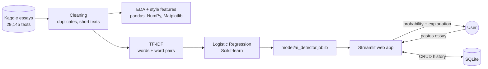

# 🔍 AI or Human? AI-Generated Essay Detector

**Mini project for Programming for Data Science (Master), Riga Nordic University**
Author: **Seyran Gurbanov**

The web app estimates whether an English essay was written by a **person** or by **AI**. It also explains its decision word by word.

- **Live app:** _link will be added after deployment_
- **Analysis notebook:** [`notebooks/AI_or_Human_Analysis.ipynb`](notebooks/AI_or_Human_Analysis.ipynb), which you can open in Google Colab

## Results (20% hold-out test set, 5,460 essays)

| Model | Accuracy | Precision | Recall | F1 |
|---|---|---|---|---|
| Random Forest (8 style features) | 0.9333 | 0.9309 | 0.9043 | 0.9174 |
| Naive Bayes (word counts) | 0.9815 | 0.9949 | 0.9597 | 0.9770 |
| **Logistic Regression (TF-IDF)**, used in the app | **0.9929** | **0.9973** | **0.9852** | **0.9912** |
| Linear SVM (TF-IDF) | 0.9963 | 0.9995 | 0.9915 | 0.9955 |

- **5-fold cross-validation F1 (Logistic Regression):** 0.9935 ± 0.0015
- **ROC-AUC:** 0.9998

Logistic Regression was chosen for the app because it gives a probability and can explain each decision word by word.

**Limitations found in the analysis:**
- Quality drops on short texts. With only 25 words, accuracy falls to about 78%.
- The model does not work on a different type of text. On scientific abstracts it labels almost every text as AI (domain shift).

## Architecture



## App pages

| Page | What it does |
|---|---|
| Check a text | Paste an essay. The app shows the AI probability, a verdict, highlighted words and a style comparison. You can save the check. |
| Dashboard | Dataset charts, model comparison, confusion matrix, ROC curve, limits, and statistics of your saved checks |
| History | CRUD on saved checks: view, review (update), delete, and export to CSV |
| About | Problem, method, limits and ethics |

## Run locally

```bash
pip install -r requirements.txt
streamlit run app.py
```

## Project structure

```
app.py                          Streamlit web app
src/text_features.py            writing-style features (shared by the notebook and the app)
notebooks/AI_or_Human_Analysis.ipynb   full analysis: cleaning, EDA, models, evaluation
notebooks/nb_source.py          source of the notebook
data/essays.csv.gz              dataset (29,145 essays, compressed)
data/external_abstracts_sample.csv   2,000 abstracts for the external test
model/ai_detector.joblib        trained model
model/model_stats.json          metrics and statistics used by the dashboard
reports/figures/                charts for the report and the presentation
```

## Data sources

- *LLM - Detect AI Generated Text Dataset*, Kaggle (Sunil Thite). Human and AI-generated student essays.
- *AI-GA: AI-Generated Abstracts dataset* (Theocharopoulos et al., 2023), https://github.com/panagiotisanagnostou/AI-GA. Used only for the external test.

## Disclaimer

The result is a **probability, not proof**. AI detectors can be wrong and must never be the only evidence against a student.
